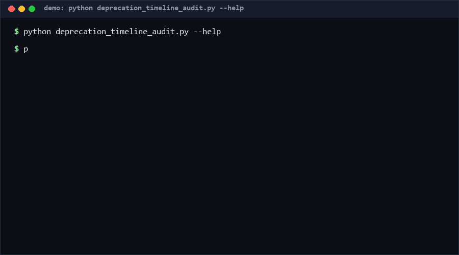

# deprecation-timeline-audit

A stdlib-only auditor for API deprecation timelines: extracts sunset dates (ISO or prose like "June 1, 2027") from declarations or docs, grades urgency (expired / imminent / soon / ok), and checks replacements, date ordering, and grace-period consistency. If you deprecate APIs faster than you remember to remove them, use this; otherwise skip it.

<p align="center"></p>

## Problem

Deprecation announcements are easy; sunsets are missed. A deprecated endpoint with no sunset date lives forever, an announced sunset passes silently, and "grace period: 90 days" turns out to exceed the actual deprecation-to-sunset span. Teams need one deterministic audit they can run on a declarations file or docs page.

## How it works

- Declarations = JSON list: `{name, deprecated, deprecation_date, sunset_date, grace_period_days, replacement}`.
- Date parsing accepts ISO `YYYY-MM-DD` and prose `Month D, YYYY` (case-insensitive); unparseable declared dates are errors, not silent skips.
- Urgency grading relative to `--today` (default: system date): sunset already passed -> ERROR; within 30 days -> ERROR (imminent); within 90 days -> WARN; otherwise clean.
- Consistency rules: deprecated without sunset_date is an ERROR; deprecation_date after sunset_date is an ERROR; missing replacement is a WARN; declared grace exceeding the deprecation-to-sunset span is a WARN; a past sunset on a non-deprecated entry is flagged stale.
- Text scan mode extracts `sunset:` mentions with line numbers from markdown/plain text.

## Quickstart (~2 min)

```bash
python deprecation_timeline_audit.py audit decls.json --today 2026-10-13   # ~0.5s
python deprecation_timeline_audit.py scan docs/deprecations.md             # extract dates
python deprecation_timeline_audit.py audit decls.json --json               # CI-friendly output
```

Then run the self-test suite: `python self_test.py` (~0.5s).

## Why not X

No direct equivalent found as of 2026-10-13: searches for "API sunset date tracker / deprecation timeline auditor" surface style guides (the RFC 8594 Sunset header) and platform dashboards, not standalone offline auditors. Nearest neighbors:

- **RFC 8594 Sunset header tooling** — covers HTTP-header transport of a sunset date; no declaration-level consistency checks (grace periods, replacements, ordering) or docs scanning.
- **OpenAPI validators (Spectral rules)** — can flag `deprecated: true` in a spec, but not timeline math against a calendar or prose sunset dates in docs.
- **API-gateway dashboards** — show live traffic on deprecated routes; they don't audit the *declaration ledger* or catch missing sunset dates before launch.
- **Calendar reminders** — manual, per-person, no exit codes, no consistency rules.

## Performance

Measured on CPython 3.13.12, Windows 10 Pro, 2026-10-13:

- Full self-test suite (73 cases): **~0.5 s** [Measured] — repro: `python self_test.py`
- Audit 500 declarations: **~3.0 ms/op** [Measured] — repro:

```bash
python -m timeit -s "import deprecation_timeline_audit as m, json, datetime; d=json.load(open('decls.json'))['declarations']; t=datetime.date(2026,10,13)" "m.audit_declarations(d, t)"
```

All operations are O(n) in declarations and O(text) in scan mode.

## Minimal Fallback

No installs needed beyond Python 3.8+. If you cannot run the auditor, keep the ledger greppable:

```bash
grep -riE "sunset" docs/ | grep -vE "[0-9]{4}-[0-9]{2}-[0-9]{2}"   # sunset mentions without dates
```

You lose urgency grading, ordering/grace checks, and the exit-code contract.

## Design Trade-offs

- **Two date formats over full locale parsing**: ISO plus "Month D, YYYY" covers the common API-doc styles without locale data files; anything else is an explicit error, never a guess.
- **30/90-day fixed thresholds**: simple and reviewable; teams wanting different windows can filter findings by code.
- **Priority order**: missed-sunset detection > declaration consistency > convenience; `deprecated=true` without a sunset is the loudest failure.

## Limits & Second-order Effects

- The scanner keys on the word "sunset"; announcements that say only "will be removed on ..." are invisible to scan mode (audit mode with explicit declarations is unaffected).
- Timezones are ignored — sunset dates are calendar dates, matching how vendors state them.
- Widely adopted, teams may push sunsets just past the 90-day warn horizon to keep dashboards green; rotate `--today` in CI with a long-horizon run to expose this.

## FAQ

**Is `--today` required?** No; it defaults to the system date. Pass it for deterministic tests and long-horizon simulations.

**Does it send anything anywhere?** No — pure stdlib, offline, deterministic given `--today`.

**When NOT to use this tool?** Skip it if your API platform already enforces sunset headers and blocks traffic at the gateway — the ledger would duplicate runtime truth. Also skip if you deprecate fewer than a handful of endpoints per year; a checklist suffices.

## [Core Assumptions]

1. Sunset dates are stated as calendar dates (no timezone semantics needed).
2. Declarations live in a machine-readable ledger (JSON) or greppable docs.
3. A deprecated endpoint without a sunset date is a defect, not a style issue.
4. Grace-period claims should be consistent with the declared deprecation-to-sunset span.

---

Confidence: High (≥80%) for parsing, grading, and consistency rules — 73 self-test cases including boundary deltas (0/1/30/31/90/91 days). Medium (60-79%) that the 30/90-day thresholds match most teams' migration windows — reasonable defaults, not survey-validated. Data as of 2026-10-13.

---

Part of the [zhengming-toolbox](https://github.com/chenhz01/zhengming-toolbox) — 105 purpose-built AI-engineering tools across neglected niches.

Related tools: [pr-size-scorer](https://github.com/chenhz01/pr-size-scorer) · [release-notes-spec](https://github.com/chenhz01/release-notes-spec) · [upgrade-risk-grader](https://github.com/chenhz01/upgrade-risk-grader)
